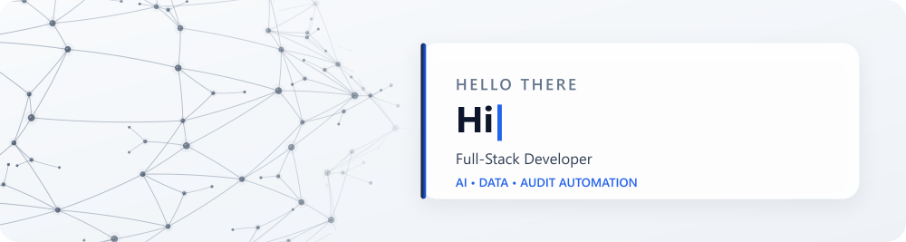

<div align="center">
  

  <br />

  <strong>Developer at Audit Sense AI · B.Tech in Artificial Intelligence &amp; Data Science</strong>

  <br /><br />

  <a href="https://www.linkedin.com/in/usman-angadi/"></a>
  <a href="https://github.com/usman20003"></a>
  
</div>

---

## 👋 About me

I'm a **Developer at Audit Sense AI**, building secure, multi-tenant audit automation and financial analytics software. I work across frontend, backend, database, security, and deployment, translating audit and business requirements into reliable product functionality.

- 🧩 Building product capabilities across **KYE, CCM, Audit Query, Audit Intelligence, and Audit Universe**
- 🏢 Working with **multi-tenant architecture, tenant isolation, RBAC, MFA, and audit trails**
- 📊 Experienced in **audit automation, data validation, KNIME workflows, dashboards, and analytics**
- 💬 Building **AI help chatbots and Ask Athena capabilities** for questions about uploaded documents and financial data, with API integrations across **OpenAI, Claude, DeepSeek, and Gemini**
- 🌐 Developing **multilingual application functionality** and integrating the **Google Translate API** for **English, Spanish, French, Arabic, Malay, and Turkish**
- ☁️ Supporting delivery with **Docker, GitHub Actions, Azure Linux VMs, Cloudflare DNS, and SSL/TLS**
- 🤖 Applying AI-assisted workflows to **research, prototyping, testing, debugging, and documentation**
- 🎓 B.Tech graduate in **Artificial Intelligence and Data Science**

## 🧰 Languages and tools

### Frontend

<p>
  
</p>

### Backend and databases

<p>
  
</p>

### Cloud, DevOps and development tools

<p>
  
</p>

### AI tools I use

<p>
  
</p>

**Claude · Codex · ChatGPT · Gemini · DeepSeek · Grok · Z.ai**

AI-assisted development for requirement analysis, prototyping, testing, debugging, and documentation.

## 💼 What I build

```yaml
product-engineering:
  - Responsive React and TypeScript interfaces
  - Node.js and Express.js REST APIs
  - Prisma schemas, PostgreSQL models, migrations and validation

architecture-and-security:
  - Multi-tenant architecture and tenant-aware data access
  - Role-based access control, MFA and audit trails
  - Secure authentication and application workflows

ai-and-chatbots:
  - AI help chatbots and conversational user interfaces
  - Ask Athena question answering using uploaded documents and financial data
  - Third-party language-model API integration

localization-and-translation:
  - Google Translate API integration
  - Multilingual interfaces and translated application content
  - English, Spanish, French, Arabic, Malay and Turkish

delivery-and-infrastructure:
  - Docker containerization and GitHub Actions CI/CD
  - Azure-hosted Linux virtual machines and SSH access
  - Cloudflare DNS, domain routing and SSL/TLS configuration
```

## 🌱 Currently growing

- Scalable full-stack and backend architecture
- Applied AI and data analytics
- Cloud deployment, automation, security, and observability
- Production-quality personal projects and technical documentation

---

<div align="center">
  <strong>Let's connect and build useful software.</strong>
  <br /><br />
  <a href="https://www.linkedin.com/in/usman-angadi/"></a>
</div>
